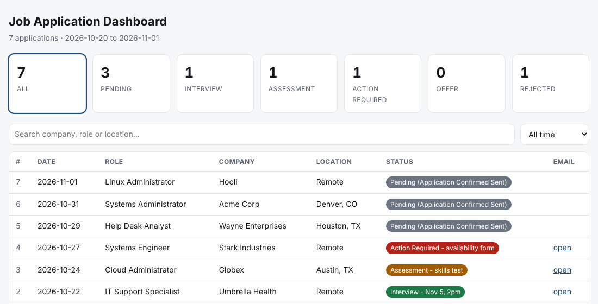
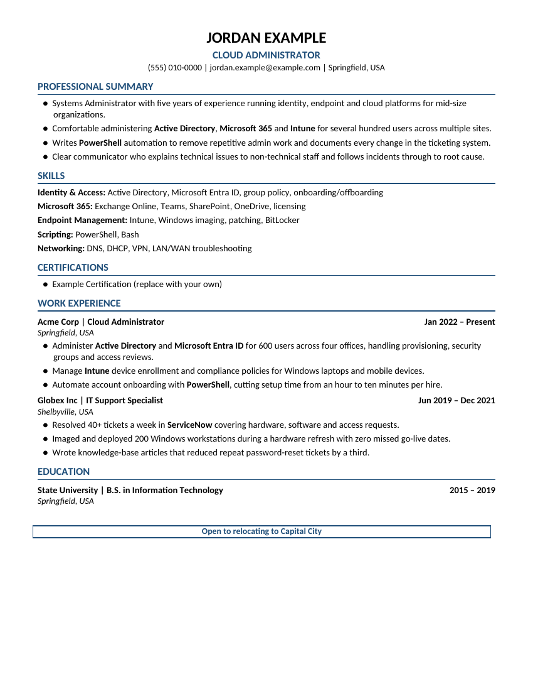

# resumekit

Tailor, build and check ATS-friendly `.docx` resumes from a single YAML profile, with a
guided Claude workflow that takes you from "here's my background" to tailored resumes and a
self-updating application dashboard.

> **Job seeker, not a developer?** Read **[GETTING_STARTED.md](GETTING_STARTED.md)**. You
> paste one line into Claude and it walks you through everything.

## The workflow

1. **Conditions first:** work permit, security clearance, pay floors (remote / near home /
   relocation), location, remote and field-job preferences, minimum JD match %
2. **Profile:** upload your resume, answer questions, or paste 5 jobs you want
3. **3 master resumes:** main target, hybrid, safety lane
4. **JobSearch folder:** everything saved on your computer
5. **Gmail:** connected so applications are tracked automatically
6. **Dashboard:** `Job_Dashboard.html` tracks every application ([details below](#-application-dashboard))
7. **Get resumes, two ways:**
   - **Say "give me first batch"**, then **"next batch"**: Claude finds jobs on JobRight
     itself and delivers **5 tailored resumes with apply links** each time
   - **Or paste job descriptions** (up to 5 at once) from any job site

   Either way, every job goes through 10 screening gates; only jobs that pass get a tailored,
   checked resume.

### Getting resumes: batch or paste

| Say | What happens |
|---|---|
| **give me first batch** | Claude opens jobright.ai, searches your target titles, keeps only jobs that apply on the company's own site (not LinkedIn/Indeed), screens them against your conditions, and builds **5 resumes** at your minimum match % or higher. You get the PDFs plus an **apply link** for each, and a one-line reason for every job it skipped. |
| **next batch** | 5 more. Claude remembers which jobs it already looked at (`batch_state.json`), rotates search titles so batches don't repeat, and builds any extra cleared job it "held" last time first. |
| *(paste 1 to 5 job descriptions)* | Same screening and build, for jobs you picked yourself. |

Batch size, source and filters are in `conditions.yaml → batch:`. Batches need a browser tool in
Claude (Claude in Chrome or the desktop app's built-in browser); without one, Claude asks you to
paste job descriptions instead.

The Claude instructions live in [`CLAUDE.md`](CLAUDE.md) and [`.claude/skills/`](.claude/skills).

## 📊 Application dashboard

Every job you apply to lands in one page, **`JobSearch/Job_Dashboard.html`**, on your own
computer. Double-click it to open it in any browser. No account, no server, no install.



### What's on it

- **Count tiles** across the top: All, Pending, Interview, Assessment, Action Required, Offer,
  Rejected. Click a tile to show only those applications.
- **Search box:** type a company, role or city.
- **Time filter:** all time, or the last 7 / 30 / 90 days.
- **Table:** number, date applied, role, company, location, status. Click any column header
  to sort.
- **Email link:** "open" jumps straight to that job's email thread in Gmail.
- **Light and dark mode** follow your computer's setting.

### Status colors

| Status | Color | Means |
|---|---|---|
| Pending (Application Confirmed Sent) | grey | Applied, no reply yet |
| Interview - *date/time* | green | Interview invite received |
| Assessment - *what* | orange | Test, skills check or assignment to do |
| Action Required - *what* | red | Something for you to do: a form, availability, documents |
| Offer | purple | Offer received |
| Rejected | light grey | Not moving forward (the dashboard remembers if you'd reached the interview stage) |

### How it stays up to date

You never edit it by hand. Just tell Claude:

| Say | Claude does |
|---|---|
| **update dashboard** | Reads only the **new** Gmail since the last sync (application confirmations, interview invites, assessments, rejections, offers), adds new rows and updates statuses |
| **applied to Acme, Systems Admin, Dallas** | Adds one row by hand (no Gmail needed) |
| *(paste a job description)* | Checks the dashboard first, so you're never sent a resume for a company you already applied to |

A small file next to it, `dashboard_sync_checkpoint.json`, remembers where the last Gmail sync
stopped, so each update is fast and nothing is counted twice. The first sync looks back 30 days.
Every change keeps a `.bak` backup beside the dashboard.

Claude also points out anything urgent after each sync (interview times, assessment
deadlines) and warns you about scam signs such as requests for money, bank details or
check deposits.

### Dashboard commands (what Claude runs for you)

```bash
python3 dashboard/dashboard.py init ~/Desktop/JobSearch                       # create a blank dashboard
python3 dashboard/dashboard.py add ~/Desktop/JobSearch/Job_Dashboard.html rows.json
python3 dashboard/dashboard.py setstatus ~/Desktop/JobSearch/Job_Dashboard.html 12 "Interview - Nov 5 2pm" --gmail <threadId>
python3 dashboard/dashboard.py check ~/Desktop/JobSearch/Job_Dashboard.html "Acme Corp"   # applied already?
python3 dashboard/dashboard.py stats ~/Desktop/JobSearch/Job_Dashboard.html               # counts by status
python3 dashboard/dashboard.py export ~/Desktop/JobSearch/Job_Dashboard.html apps.csv     # to a spreadsheet
```

`rows.json` is a list like
`[{"date": "2026-11-02", "role": "Systems Administrator", "company": "Acme Corp", "location": "Dallas, TX"}]`.

## The toolkit

Applying to many jobs means making many slightly different resumes. `resumekit` keeps your
real history in one profile file, lets you write small per-job override files, and catches the
mistakes that slip in when you're on resume number forty:

- **build**: render a clean, single-column, ATS-readable `.docx` (and PDF via LibreOffice)
- **lint**: refuse to build if the content mentions tools or certifications you've banned, uses
  present tense for past jobs, or is too long/short
- **bold**: bold job-description keywords inside bullets (capped per bullet, so it stays readable)
- **check**: inspect the rendered PDF for orphaned headers, split bullets, page overflow and
  an underfilled last page
- **gate**: check a job description against your `conditions.yaml`: pay below your floor
  (top of range, yearly converted at 2,080 h), and red-flag phrases for clearance, citizenship /
  ITAR, no-sponsorship, OPT/CPT exclusions, internal-only and field roles
- **screen**: before tailoring, check whether you've already applied to that company, with
  rarity-ranked fuzzy matching so "Credit Union" doesn't flag every credit union



## Install

```bash
pip install git+https://github.com/Nithin4517/resumekit.git
```

PDF conversion needs [LibreOffice](https://www.libreoffice.org/) (`soffice` on your PATH).

## Quick start

```bash
cp examples/profile.yaml my_profile.yaml        # my_*.yaml is gitignored
resumekit lint  my_profile.yaml -r examples/rules.yaml
resumekit build my_profile.yaml -t examples/tailor_cloud_role.yaml -o out/Resume_Acme.docx --pdf
resumekit check out/Resume_Acme.pdf --max-pages 2
```

### Profile

```yaml
name: Jordan Example
headline: Systems Administrator
contact: ["(555) 010-0000", jordan.example@example.com, Springfield, USA]
summary:
  - "Comfortable administering **Active Directory** and **Intune** ..."   # **x** = bold
skills:
  Identity & Access: Active Directory, Microsoft Entra ID
certifications: [ ... ]
experience:
  - company: Acme Corp
    title: Systems Administrator
    dates: Jan 2022 – Present
    location: Springfield, USA
    bullets: [ ... ]
education:
  - {school: State University, degree: B.S. in IT, dates: 2015 – 2019}
note: Open to relocating          # optional boxed line at the bottom
style: {font: Calibri, accent: 1F4E79}
```

### Per-job tailoring

A tailoring file overrides only what changes. Experience entries are matched by company:

```yaml
headline: Cloud Administrator
summary: [ ... ]                 # replace the summary for this job
experience:
  Acme Corp:
    title: Cloud Administrator
    bullets: [ ... ]
```

### Lint rules

```yaml
banned: ['\bSCCM\b', 'Security\+']   # regexes, case-insensitive
min_words: 450
max_words: 1100
summary_bullets: [4, 6]
bullets_per_role: [3, 8]
require_past_tense: true             # roles whose dates don't say "Present"
```

`resumekit build ... -r rules.yaml` refuses to build when lint fails.

### Bold keywords after the fact

```bash
resumekit bold out/Resume_Acme.docx "ServiceNow" "Intune" "PowerShell" --max 3
```

### Job conditions gate

```bash
cp examples/conditions.yaml my_conditions.yaml
resumekit gate my_conditions.yaml jd.txt --where relocation   # or remote / near_home
# FLAG clearance:  ...Must be able to obtain a Secret clearance...
# PAY  SKIP: top of range $28.85/hr vs relocation floor $30.00/hr - pay is less
```

### Duplicate-application screen

```bash
resumekit screen "Initech" "Umbrella Corp" --log applications.csv --folder out/ --ignore yourname
```

Verdicts are `DUPLICATE`, `REVIEW` or `CLEAR`. The log is any CSV with a `company` column.

## Python API

```python
from resumekit import build, merge, lint, bold_docx, check_pdf
from resumekit.builder import load_file

data = merge(load_file("my_profile.yaml"), load_file("tailor.yaml"))
assert not lint(data, load_file("rules.yaml"))
build(data, "out/Resume.docx")
```

## Contributing

Issues and pull requests are welcome, especially new layout checks, templates and
non-English verb lists for the tense check. Run `pip install -e .[dev] && pytest` before
opening a PR.

## License

MIT
